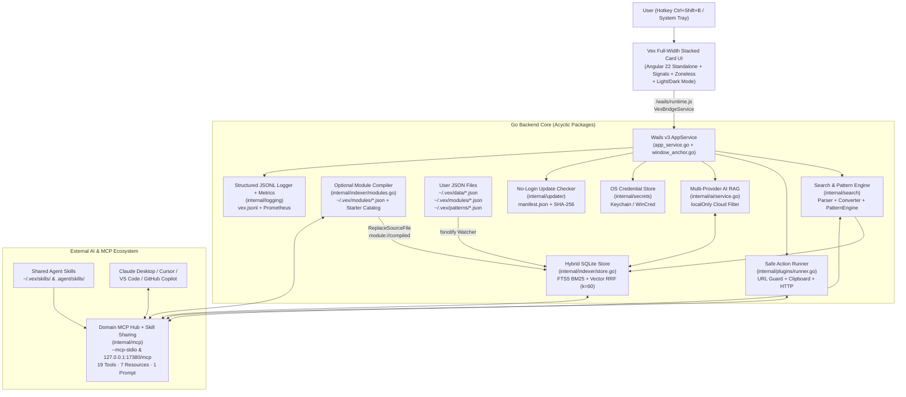

# Vex — System Overview, Architecture & Design Decisions

> **What is Vex?**
> **Vex** is a desktop-first, platform-agnostic, local-first knowledge Rolodex, configurable pattern decoder, and MCP hub built with **Go + Wails v3** and **Angular 22 (Zoneless)**.

---

## 1. High-Level System Architecture

---

## 2. Core Design Decisions

### A. Single Unified Desktop App (Platform-Agnostic)
- Vex ships as one unified desktop application (`buildinfo.go`: `AppName`, `AppVersion`, `UpdateFeedURL`) with no community/enterprise code split and no CLI TUI.
- All UI controls are strictly platform-agnostic — zero OS-specific window buttons or key symbols.

### B. 100% Optional, Deletable Modules (`internal/indexer/modules.go`, `starter_modules/`)
- `LoadAllModules(modulesDir)` reads **only** `.json` manifests present in `~/.vex/modules/`.
- Packaged starter packs (`air-carriers`, `ocean-carriers`, `containers`, `logistics-dictionary`, `reference-patterns`, `team-templates` — zero dummy/sample data) are embedded strictly as an optional catalog (`ListStarterModules`, `InstallStarterModules`).
- Installing a starter module writes an editable `.json` file into `~/.vex/modules/<id>.json`. Deleting it removes the file permanently and hot-reloads the SQLite index and `PatternEngine` via `Watcher.SetModulesWatcher`.

### C. Full-Width Stacked Nested Card System (`frontend/src/app/`)
- Responsive `420px–520px` (default `460px`, `max-height: 680px`) internal-scrolling desktop widget supporting Light (`[data-theme="light"]`) and Dark (`[data-theme="dark"]`) modes.
- **No vertical accordion tree lines**: Every nested child spans **100% of its parent's inner width** stacked with `gap: 8px`, communicating depth (L0 → L1 → L2) strictly via alternating inset surfaces and `1px` borders.
- Every template extends `BaseCardTemplate<T>` and is registered in `CardTemplateRegistry` for recursive `*ngComponentOutlet` rendering inside `RolodexCardShellComponent` (see **[docs/TEMPLATE_BLUEPRINTS.md](TEMPLATE_BLUEPRINTS.md)** for ASCII layout blueprints, field-to-slot tables, and cross-domain JSON examples of every template):
  - **`location`** (`LocationCardComponent`): Strictly header-only (UNLOC·IATA blue chip, live IANA clock, green currency, temp; no addresses/phones); expands directly into full-width nested child cards.
  - **`server-matrix`** (`ServerMatrixCardComponent`): Stoplight `● DEV` / `● QA` / `● PROD` rows with monospace hostname and inline `[Copy]`, `[SSH]`, and `[↗]` buttons.
  - **`website-link`** (`WebsiteLinkCardComponent`): Multi-Chip Mode (2+ links) expands to launch/copy rows; Single-Button Mode (1 link) omits the chevron and renders the entire card as one clickable button with a top-right `↗`.
  - **`pattern-breakdown`** (`PatternBreakdownCardComponent`): 3-column equal-width Blue/Amber/Green segment tile grid (`Value` + `ROLE` + `Meaning`) + plain-English explanation + full-width nested entity cards.
  - **`conversion`** (`ConversionCardComponent`): Compact `Input ⇄ Output` strip with 1-click Copy and equivalent chips.
  - **Extended templates**: `container-blueprint` (theme-adaptive SVG schematic + Metric/Imperial toggle + capacity boxes), `dictionary-guide` (N-step timeline), and `kv-grid` (click-to-copy key-value grid).
- `VexBridgeService` isolates all Wails v3 RPC calls (`import('/wails/runtime.js')`) and returns clean empty state when opened outside Wails (zero hardcoded demo data in the bundle).

### D. Loadable, Configurable Pattern Engine (`internal/models/pattern.go`, `internal/search/patterns.go`)
- Zero hardcoded rules in Go: active rules come solely from enabled modules (`ModuleManifest.Patterns`) and `~/.vex/patterns/*.json`.
- Supports `enabled`, `priority`, pre-match `normalize` transforms, checksums (`iata-mod7`, `iso6346`, `luhn`), 3-column `segments[]` + `explanationTemplate`, live SQLite `dataLookups` across indexed modules, declarative recursive `linkRules` (`autoExpand`, `nestChildren`, `copyChildrenOnly`, `attachUnder`, `maxDepth`), optional `liveMcp` lookups, and `TestRule` dry runs.

### E. Tri-Modal MCP Hub, Agent Skill Sharing & Security (`internal/mcp/`, `internal/secrets/`, `internal/plugins/runner.go`)
- **MCP Server (`HubServer`)**:
  - **7 Resources & Templates**: `search://collections`, `schema://search-card`, `card://{collection}/{id}`, `search://modules`, `search://patterns`, `search://skills`, `skill://{name}`.
  - **19 Tools**: `search_knowledge` (returns both `card` and projected `cardNode`), `get_card_schema`, `preview_raw_data_sample`, `transform_and_import_data`, `upsert_card`, `batch_upsert_cards`, `list_plugins`, `execute_card_action`, `get_related_cards`, `list_modules`, `get_module`, `upsert_module`, `delete_module`, `install_starter_module`, `list_pattern_rules`, `upsert_pattern_rule`, `delete_pattern_rule`, `list_skills`, `get_skill`.
  - **1 Prompt**: `rag_context_prompt`.
- **Security Controls**: Loopback-only HTTP with Host/Origin CSRF & DNS-rebinding guard (`loopbackGuardMiddleware`), strict HTTP/HTTPS URL validation, no arbitrary shell execution, `localOnly` cloud-RAG stripping, and native OS credential storage (`internal/secrets`).

### F. Local Observability, Autostart & Viewport Anchoring
- `internal/logging`: Rotating `slog` JSONL logs (`~/.vex/logs/vex.jsonl`, `0o600`, never writes to `stdout`) + Prometheus `/metrics`.
- `internal/updater`: No-login `manifest.json` checker (HTTP/HTTPS or local/shared path) with SHA-256 verification.
- `window_anchor.go`: Pure-Go work-area placement clamping and upward-flip detection (`AnchorDown` / `AnchorUp`).
