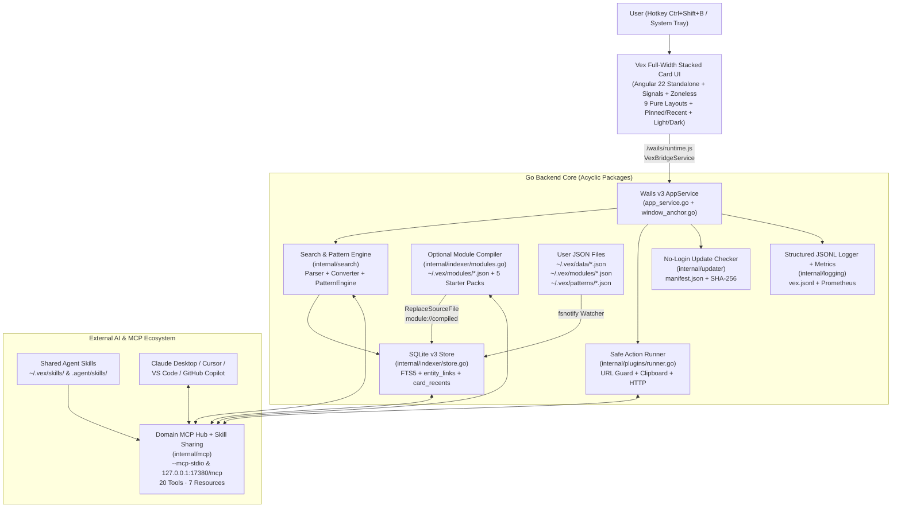

# Vex — System Overview, Architecture & Design Decisions

> **What is Vex?**
> **Vex** is a desktop-first, platform-agnostic, local-first knowledge Rolodex, configurable pattern decoder, and MCP hub built with **Go + Wails v3** and **Angular 22 (Zoneless)**.

---

## 1. High-Level System Architecture

---

## 2. Core Design Decisions

### A. Single Unified Desktop App (Platform-Agnostic)
- Vex ships as one unified desktop application (`buildinfo.go`: `AppName`, `AppVersion`, `UpdateFeedURL`) with no community/enterprise code split, no CLI TUI, and no embedded AI/RAG layer.
- All UI controls are strictly platform-agnostic — zero OS-specific window buttons or key symbols (`⌘`, `⌥`, `Win`).

### B. 100% Optional, Deletable Modules (`internal/indexer/modules.go`, `starter_modules/`)
- `LoadAllModules(modulesDir)` reads **only** `.json` manifests present in `~/.vex/modules/`.
- Packaged starter packs (`air-carriers`, `ocean-carriers`, `containers`, `logistics-dictionary`, `reference-patterns` — flat-on-disk 9-layout JSON, zero hardcoded sample data in runtime code) are embedded strictly as an optional catalog (`ListStarterModules`, `InstallStarterModules`).
- Installing a starter module writes an editable `.json` file into `~/.vex/modules/<id>.json`. Deleting it removes the file permanently and hot-reloads the SQLite index and `PatternEngine` via `Watcher.SetModulesWatcher`.

### C. Full-Width Stacked Nested Card System — 9 Pure Generic Layouts (`frontend/src/app/`)
- Responsive `420px–520px` (default `460px`, `max-height: 680px`) internal-scrolling desktop widget supporting Light (`[data-theme="light"]`) and Dark (`[data-theme="dark"]`) modes.
- **No vertical accordion tree lines**: Every nested child spans **100% of its parent's inner width** stacked with `gap: 8px`, communicating depth (L0 → L1 → L2) strictly via alternating inset surfaces and `1px` borders.
- **Zero empty accordions**: `RolodexCardShellComponent` omits the expand chevron whenever a card has neither renderable leaf content nor children. Active Level 0 pins always render the `--chip-blue-bg` / `--chip-blue-border` highlight (including on `link` cards), and any header chip with a valid IANA timezone renders a live 24h monospace clock across all 9 layouts.
- **Pinned + Recent Empty State & Keyboard Flow (`AppComponent`)**: When search is empty, displays **Pinned** (max 3) and **Recent** (last 6 from `ListRecentCards`) plus subtle total indexed card count (`ListCollections`). Expanding, opening, or copying any card calls `RecordCardUsed(id)`. Full launcher keyboard flow supports `ArrowDown`/`ArrowUp` selection, `Enter` primary action (open `link`, copy `convert`, or toggle expand), and two-stage `Escape` (clear query → hide window).
- Every layout extends `BaseCardTemplate<T>` and is registered strictly in `CardTemplateRegistry` (zero legacy aliases; see **[docs/TEMPLATE_BLUEPRINTS.md](TEMPLATE_BLUEPRINTS.md)**):
  1. **`group`** (`GroupCardComponent`): Strictly header-only container; renders only stacked `children[]`.
  2. **`link`** (`LinkCardComponent`): Single-Button clickable card rendered by shell with top-right `↗` and no chevron.
  3. **`action-list`** (`ActionListCardComponent`): Compact rows with optional stoplight badge, primary text (optional mono), subtitle, and 1–3 `copy`/`open_url` buttons.
  4. **`facts`** (`FactsCardComponent`): Optional summary, optional segmented `views[]` switcher (e.g. Metric / Imperial), and read-only `Label / Value` grid with `[Copy]` rendered strictly when `fact.copyable === true`.
  5. **`segments`** (`SegmentsCardComponent`): 2–4 equal-width Blue/Amber/Green click-to-copy token tiles + 1–2 sentence explanation + nested children.
  6. **`steps`** (`StepsCardComponent`): N-step visual timeline + summary + optional bullets.
  7. **`convert`** (`ConvertCardComponent`): `Input ⇄ Output` strip + 1-click `[Copy]` + clickable equivalent pills.
  8. **`table`** (`TableCardComponent`): Sticky header (2–4 cols, max 8 visible rows), optional mono columns, `[Copy CSV]` and `[Copy MD]` footer buttons.
  9. **`snippet`** (`SnippetCardComponent`): Optional compact inline `{{var}}` inputs live-interpolated into a monospace block + 1-click `[Copy]`.
- `VexBridgeService` isolates all Wails v3 RPC calls (`import('/wails/runtime.js')`) and returns clean empty state when opened outside Wails.

### D. SQLite v3 Precision Search, Flat-on-Disk Nesting & Pattern Engine (`internal/indexer/store.go`, `internal/search/`)
- **SQLite Schema v3 (`PRAGMA user_version = 3`)**: Automatic idempotent in-place migration maintains `cards` (with `entity_key`, `entity_code`, `parent_entity_key`, `chips_text`, `related_keys_json`), 9-column `cards_fts`, `entity_links` (`child_of` / `related_to`) for dynamic 2-level cross-module child hydration, and `card_recents` for usage-ordered empty-state recents. `SearchCard.SearchableBody()` uses a strict layout-aware whitelist (never indexing URLs, tones, or structural JSON keys).
- **4-Tier Ranking & Anti-Sprawl Cutoff (`SearchHybrid`)**: Ranks exact entity/code/tag/chip matches (`exact`, `88–100`) first, followed by 1-hop contextual neighbors (`contextual`, `52–78`) and whole-token FTS5 BM25 (`45–75`), then prefix FTS5 (`16–38`), and guarded metadata-only substring fallback (`fuzzy`, `5–14`), with a dynamic relevance cliff and a `10`-card active search limit.
- **Loadable, Configurable `PatternEngine`**: Zero hardcoded rules in Go — active rules come solely from enabled modules (`ModuleManifest.Patterns`) and `~/.vex/patterns/*.json`. Emits `layout: "segments"` by default with `normalize`, checksums (`iata-mod7`, `iso6346`, `luhn`), live SQLite `dataLookups` (`fact.<Label>`), recursive `linkRules`, optional `liveMcp`, and `TestRule` dry runs.

### E. Strict Schema Validation, MCP Hub & Security (`internal/models/layouts.go`, `internal/mcp/`, `internal/plugins/runner.go`)
- **Compiler-as-Referee Validation**: `ValidateAndNormalizeCard`, `ValidateModuleManifest`, `ValidateModuleJSON`, CLI `vex validate <path.json>`, and MCP `validate_module` enforce strict `additionalProperties: false` payload decoding, zero header-to-body chip echoes, max nesting depth 2, and zero legacy aliases.
- **MCP Server (`HubServer`)**:
  - **7 Resources & Templates**: `search://collections`, `schema://search-card`, `card://{collection}/{id}`, `search://modules`, `search://patterns`, `search://skills`, `skill://{name}`.
  - **20 Tools**: `search_knowledge`, `get_card_schema`, `validate_module`, `preview_raw_data_sample`, `transform_and_import_data`, `upsert_card`, `batch_upsert_cards`, `list_plugins`, `execute_card_action`, `get_related_cards`, `list_modules`, `get_module`, `upsert_module`, `delete_module`, `install_starter_module`, `list_pattern_rules`, `upsert_pattern_rule`, `delete_pattern_rule`, `list_skills`, `get_skill`.
- **Security Controls**: 100% local-first data in `~/.vex`, loopback-only MCP HTTP with Host/Origin CSRF & DNS-rebinding guard (`loopbackGuardMiddleware`), strict HTTP/HTTPS URL validation, and zero arbitrary shell execution.

### F. Local Observability, Autostart & Viewport Anchoring
- `internal/logging`: Rotating `slog` JSONL logs (`~/.vex/logs/vex.jsonl`, `0o600`, never writes to `stdout`) + Prometheus `/metrics`.
- `internal/updater`: No-login `manifest.json` checker (HTTP/HTTPS or local/shared path) with SHA-256 verification.
- `window_anchor.go`: Pure-Go work-area placement clamping and upward-flip detection (`AnchorDown` / `AnchorUp`).
