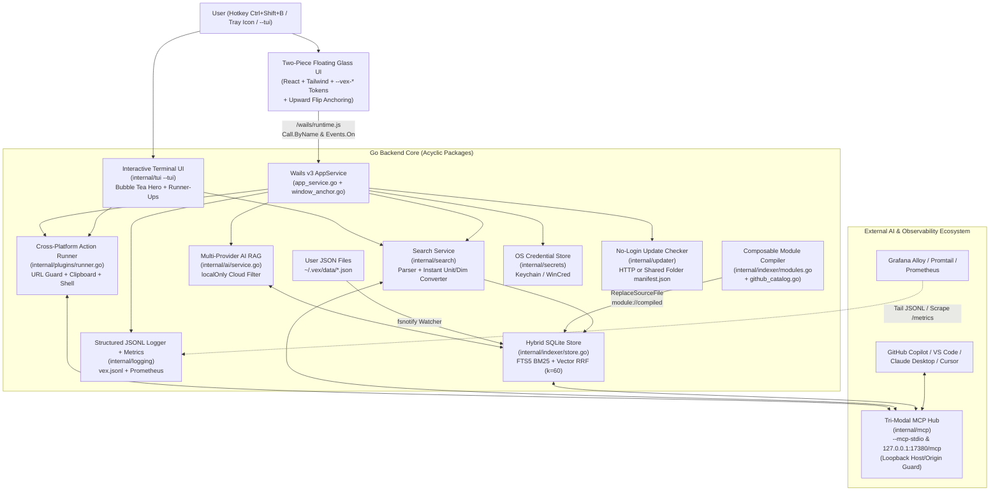

# Vex — System Overview, Architecture & Design Decisions

> **What is Vex?**
> **Vex** is a calm, local-first desktop search launcher and modular knowledge hub where your websites, notes, reference modules, unit conversions, and AI/MCP tools are one keyboard shortcut away (`Ctrl+Shift+B`).

---

## 1. High-Level System Architecture

---

## 2. Plain-English Overview (For Non-Technical Users)

1. **Press One Shortcut (`Ctrl+Shift+B`)**: A sleek, floating search pill appears over whatever you're working on — no cluttered browser tabs, SharePoint folders, or spreadsheets.
2. **Get Instant "Aha!" Answers**:
   - Type **`AMS`** to see Amsterdam's port/airport codes (`NLAMS` / `AMS`), live local time, current weather, currency (`EUR €`), plus customs acronyms and internal portals.
   - Type **`1588 kg to lbs`**, **`-30c to f`**, or **`120x80x100 cm`** to convert units or calculate cargo volume (`CBM`) and IATA air volumetric weight instantly.
   - Press **`⌘1`–`⌘5`** (or click a category) to filter by topic without memorizing any special syntax.
3. **Only See What Fits Your Role**: Open **Settings → Modules** to toggle knowledge packs on or off (*Geographies*, *Air Freight*, *Ocean Freight*, *Customs*, *Transcon*, *Global Technology*, *GitHub Catalog*). Turning a module off immediately hides its cards and overlays.
4. **Stay Private & Fast**: Everything runs locally on your computer. No accounts, no logins, no cloud lock-in.

---

## 3. Detailed Feature Architecture & Design Intent (For Engineers & AI Agents)

### A. JSON-First Storage + Embedded SQLite FTS5/Vector Index (`internal/indexer/`)
- **Intent**: Human-readable, Git-shareable JSON files are the source of truth (`~/.vex/data/*.json` and `~/.vex/modules/*.json`), while an embedded CGo-free SQLite database (`modernc.org/sqlite`) provides sub-millisecond FTS5 BM25 + optional Vector Cosine RRF (`k=60`) search.
- **Why**: Zero external database setup, instant offline speed, and effortless sharing of JSON cards/modules between teammates.

### B. Composable Modules, Card Overlays & Cross-Card Synergy (`internal/models/`, `internal/indexer/modules.go`)
- **Problem Solved**: How do you let 7+ domain modules enrich the same real-world entity (like `AMS`) without overwriting each other's fields or overwhelming non-technical users?
- **Design Decision**:
  - Canonical **`EntityKey`** (e.g., `"loc:AMS"`, `"uld:AKE"`, `"repo:gt-customs-..."`) links modules without brittle hardcoded IDs.
  - Each active module attaches an isolated, attributed **`CardSection`** (`{ moduleId, badge, title, notes, fields, actions, provenance }`).
  - **Standalone Promotion**: If a user turns OFF `Geographies` and keeps only `Air Freight` or `Global Technology` ON, overlays targeting `loc:AMS` automatically promote into standalone cards so every module works both independently and combined.
  - **Cross-Card Synergy (`FindRelatedCards`)**: Distinct cards sharing `EntityKey`, `RelatedKeys`, or domain tags (e.g., `Amsterdam Port` ↔ `AMS Ocean Portal` ↔ `AMS Acronym`) appear as clickable **"Related in Enabled Modules"** chips.

### C. Taming Card Density: Glance Pills + Single-Tab Perspectives (`internal/models/card.go`, `CardRenderer.tsx`)
- **Intent**: Users should often get their answer directly on the small list row without even expanding the card, and the full card view should never become a wall of stacked tables.
- **Design Decision**:
  - **`ComputeGlancePills(card)`** runs in Go to attach up to 3 high-signal pills (`[NLAMS · AMS]`, `[EUR (€)]`, `[Portfolio: Customs]`) to every compact row.
  - **Single Active Perspective Tab**: The full card view renders a tab bar (`Overview` | `Air` | `Ocean` | `Customs` | `Global Tech`), showing one perspective at a time and auto-selecting a module tab if your search query matched inside it (e.g., searching `ams-prd-edi01` auto-opens `Global Tech` on `AMS`).

### D. Source Provenance for Human Trust & LLM/MCP Fact-Checking (`Provenance`)
- **Intent**: When an AI assistant (RAG or MCP client) or human reads a compliance rule (like OFAC sanctions or HS duty rates), they need to know where it came from and how fresh it is.
- **Design Decision**: Every `SearchCard` and `CardSection` carries optional `Provenance{SourceName, SourceURL, VerifiedAt, Authority}` (`official`, `internal-curated`, `automated-sync`), rendered subtly in the card footer and injected directly into AI RAG & MCP citations.

### E. Instant Unit Converter & Declarative Pattern Recognition (`internal/search/converter.go`, `internal/search/patterns.go`)
- **Intent**: Handle everyday logistics/office math (`1588 kg to lbs`, `-30c to f`, `120x80x100 cm`) and opaque reference numbers (`176-12345675` IATA AWB, `MSCU123456...` ISO 6346 container, `AB#48219` ADO work item, or custom `~/.vex/patterns/*.json` House/Master Bill rules) in <0.1 ms locally, enriching matches with linked `EntityKey` cards and optional live MCP tool lookups (`LocalOnly: true`).
- **Design Decision**: Pure-Go converter + RE2 `PatternEngine` inside `search.Service` (bridged to `internal/mcp.ClientManager` via the acyclic `LivePatternExecutor` interface) so Desktop GUI, `--tui`, and MCP share one decoding pipeline. See **[ADR-001](ADR-001-enterprise-auth-and-patterns.md)** for the full security model (`gh auth` / `az login` read-only CLI probing + MCP-first delegation) and drop-in JSON pattern schema.

### F. Lightweight GitHub Engineering Catalog (`internal/indexer/github_catalog.go`)
- **Intent**: Let engineers search portfolios, teams, products, and repos without cloning gigabytes of code.
- **Design Decision**: Parses the `<prefix>-<portfolio>-<team>-<product>-<component>` naming convention from lightweight JSON metadata (`gh repo list --json ...`) into individual repo cards + automatic **Portfolio Roll-Up Directory Cards**.

### G. Tri-Modal MCP Hub & Security Posture (`internal/mcp/`, `internal/plugins/runner.go`)
- **Intent**: Let external AI agents (VS Code GitHub Copilot, Copilot CLI, Claude Desktop, Cursor) query, import, and traverse Vex's local knowledge safely.
- **Security Controls**:
  - Loopback-only HTTP binding (`127.0.0.1:17380`) with **`loopbackGuardMiddleware`** rejecting non-loopback `Host` headers (DNS rebinding) and cross-origin `Origin` headers (CSRF).
  - Strict **`validateHTTPURL`** on `open_url` / `open_pwa` blocking non-`http(s)` schemes and shell metacharacters.
  - **No Arbitrary Shell Execution**: Cards, plugins, and MCP tools cannot invoke `sh -c` / `cmd /c`; CLI snippets use `copy` actions.

### H. Local-First Observability & No-Login Updates (`internal/logging/`, `internal/updater/`)
- **Logging**: Go stdlib `log/slog` JSONL rotating file writer (`~/.vex/logs/vex.jsonl`, 5 MB × 3 backups, `0o600`, never writes to `stdout` so `--mcp-stdio` stays clean) + zero-dependency Prometheus `/metrics` at `http://127.0.0.1:17380/metrics` ready for Grafana Alloy / Loki / Prometheus.
- **No-Login Updates**: Checks a simple `manifest.json` from an HTTP/HTTPS URL or shared network folder (`3s` timeout, fails silently offline) with semver comparison and SHA-256 verification.

### I. Enterprise Guardrails, Upward Flip Anchoring & Terminal UI (`internal/secrets/`, `window_anchor.go`, `internal/tui/`)
- **`localOnly` Cloud RAG Filter**: Modules, cards, or overlay sections marked `localOnly: true` are automatically stripped from external cloud LLM prompts and embeddings (`openai`, `anthropic`, `gemini`) while remaining 100% available in local search and local `ollama` RAG.
- **Native OS Secret Store (`internal/secrets/`)**: AI API keys are stored in macOS Keychain (`/usr/bin/security`) or Windows Credential Manager (`advapi32.dll` `CredReadW`/`CredWriteW`/`CredDeleteW`) and scrubbed from `config.json` (with automatic startup migration for legacy plaintext keys).
- **Viewport-Aware Upward Flip (`window_anchor.go`)**: Pure-Go display geometry detects when Vex spawns from the bottom-right tray or bottom 25–30% of the active display's work area, anchoring the window cleanly inside the work area and flipping the UI stack (`anchor === 'up'`, `flex-col-reverse`) so results expand upward without clipping.
- **Interactive Bubble Tea TUI (`internal/tui/`, `--tui`)**: Terminal UI directly consuming `internal/search`, `internal/indexer`, and `internal/plugins` with `1–4` (`Alt+1–5`) category filters, Primary Hero Card + `Tab`/`Shift+Tab` perspective tabs, compact runner-ups, and unit/volumetric math.
- **Framework-Agnostic Frontend Readiness**: All search, module merging, glance pills, conversions, and taxonomy parsing run in Go; `frontend/src/lib/bridge.ts` is a pure ES module with zero React dependencies; `frontend/src/index.css` exposes `--vex-*` CSS Custom Properties.
