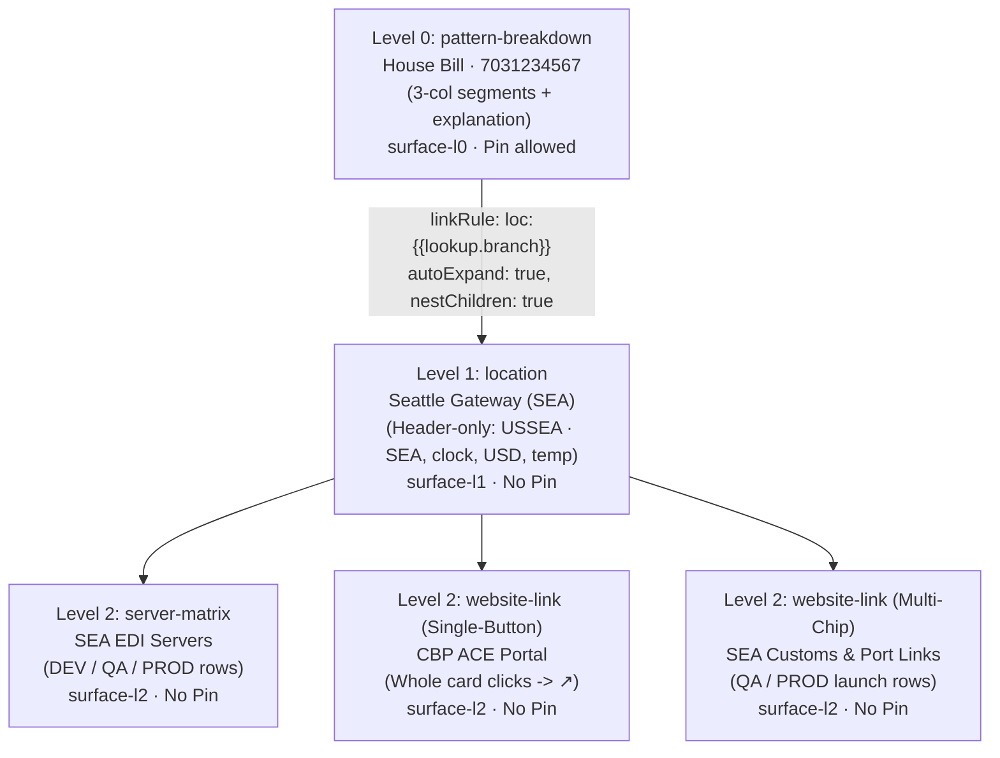

# Vex — Card Template Layout Blueprints & Data Examples

This reference documents the **visual layout blueprint**, **slot-to-field mapping**, and **concrete cross-domain JSON examples** for every card template registered in Vex (`CardTemplateRegistry`). Use it when authoring optional JSON modules (`~/.vex/modules/`), pattern rules (`~/.vex/patterns/`), ETL mappings (`transform_and_import_data`), or live updates over MCP (`upsert_module`, `upsert_card`, `upsert_pattern_rule`).

---

## 1. Universal Card Shell & Nesting Rules

Every card—regardless of template—is rendered by `RolodexCardShellComponent` inside a responsive `420px–520px` (default `460px`, `max-height: 680px`) internal-scrolling frame with **Light & Dark mode** (`[data-theme="light"]` / `[data-theme="dark"]`).

### Visual Shell Anatomy (0 → 1 → 2 Full-Width Stacking)

```text
╔══════════════════════════════════════════════════════════════╗  ← Level 0 Card
║  [Icon]  Title (15px semibold)                    [📌]  [▼]  ║    Light: #ffffff / border #e4e7ec / r=12px / p=12px
║  [Chip 1]  [Chip 2]  [Chip 3]  [Chip 4]                      ║    Dark:  #18181b / border #27272a
╟──────────────────────────────────────────────────────────────╢  ← 1px divider (ONLY when expanded)
║  ┌─ Template Leaf Body (optional, via NgComponentOutlet) ─┐  ║
║  └────────────────────────────────────────────────────────┘  ║
║  ┌────────────────────────────────────────────────────────┐  ║  ← Level 1 Child (100% width, NO left rail, NO pin)
║  │ [Icon] Nested Title (14px semibold)                [▼] │  ║    Light: #f8f9fb / border #e4e7ec / r=10px / p=10px
║  │ [Chip 1]  [Chip 2]  [Chip 3]                           │  ║    Dark:  #202024 / border #2e2e33
║  ├────────────────────────────────────────────────────────┤  ║
║  │ ┌────────────────────────────────────────────────────┐ │  ║  ← Level 2 Child (100% width, max depth = 2)
║  │ │ [Icon] Deep Child Title (14px semibold)        [▸] │ │  ║    Light: #ffffff / border #e4e7ec / r=10px / p=10px
║  │ │ [● DEV]  [● QA]  [● PROD]                          │ │  ║    Dark:  #18181b / border #2e2e33
║  │ └────────────────────────────────────────────────────┘ │  ║
║  └────────────────────────────────────────────────────────┘  ║
╚══════════════════════════════════════════════════════════════╝
   Vertical gap between stacked children: 8px (zero left-rail lines)
```

### Universal Header & Chip Rules
- **Pin Button (`📌`)**: Shown **only** on Level 0 cards (`depth === 0 && pinnable !== false`). Max **3 pins** globally; pinned state displays a blue-tinted pill (`--chip-blue-bg`).
- **Glance Chips (`chips[]`)**: Max **4 chips** displayed in Row 2 (`gap: 6px; flex-wrap: wrap`).
  - **Tones**: `"blue"` (codes/modes), `"green"` (`DEV`/valid/currency), `"amber"` (`QA`/branch/highlight), `"red"` (`PROD`/alert), `"neutral"` (general), `"mono"` (monospace values).
  - **Stoplight Dots (`dot`)**: Optional `"green" | "amber" | "red"` dot; any chip with a `dot` automatically renders as an uppercase rounded pill (`border-radius: 999px`).
  - **Live IANA Clock Chip**: Pass any valid IANA timezone with a slash and no spaces as `chip.label` (e.g., `"Europe/Amsterdam"`, `"America/Los_Angeles"`). `RolodexStateService` automatically renders it as a live 24-hour monospace clock (`08:09`) updating every 30 seconds.
  - **Auto-Monospace Detection**: Port codes (`NLAMS · AMS`), clocks (`08:09`), temperatures (`14°C`), ISO codes (`ISO 45G1`), and container dimensions (`40'×8'×9'6"`) automatically render in `var(--font-mono)`.

### Quick Template Picker

| Need | Use Template (`template`) | Nestable? |
| :--- | :--- | :--- |
| Hub/region/gateway/office container with live clock & children | **`location`** | Yes (L0 or L1) |
| Environment hostnames with Copy / SSH / Open buttons | **`server-matrix`** | Yes (L0–L2) |
| 2+ environment portal links OR 1 direct click-to-open link card | **`website-link`** | Yes (L0–L2) |
| Decoded ID/reference with 3 color-coded segment tiles + linked entities | **`pattern-breakdown`** | Yes (L0) |
| Instant `Input ⇄ Output` calculation with equivalents | **`conversion`** | Yes (L0–L2) |
| Technical container/equipment schematic + Metric/Imperial + pallet capacity | **`container-blueprint`** | Yes (L0–L2) |
| N-step lifecycle/SOP timeline + plain-English explanation | **`dictionary-guide`** | Yes (L0–L2) |
| Generic index record (carriers, SCACs, flags, services) with copyable fields | **`kv-grid`** | Yes (L0–L2) |
| Opt-in standalone on-call / escalation desk contact rows (never inside `location`) | **`branch-contact`** | Yes (L0–L2) |

---

## 2. Canonical Generic Templates (5 Core Classes)

---

### 2.1 `location` — Header-Only Entity Container

> **Strict Contract**: `LocationCardComponent` renders **NO leaf body**—never put street addresses, phone numbers, or contact rows in a `location` card. Expanding a `location` card reveals **only** its full-width stacked `children[]`. (`branch-gateway` is a backwards-compatible alias.)

#### Layout Blueprint
```text
┌──────────────────────────────────────────────────────────┐
│ 🇳🇱  Amsterdam Gateway (AMS)                   [📌]  [▼] │  ← icon + title (15px) + L0 pin + chevron
│ [NLAMS · AMS]  [08:09]  [EUR €]  [14°C]                  │  ← blue mono · live IANA clock · green · mono
├──────────────────────────────────────────────────────────┤  ← 1px divider (no leaf body!)
│ ┌──────────────────────────────────────────────────────┐ │
│ │ 🖥️  AMS EDI Servers                              [▸] │ │  ← child 1: server-matrix (surface-l1)
│ │ [● DEV]  [● QA]  [● PROD]                            │ │
│ └──────────────────────────────────────────────────────┘ │
│ ┌──────────────────────────────────────────────────────┐ │
│ │ 🔗  AMS Customs & Port Links                     [▸] │ │  ← child 2: website-link multi-chip (surface-l1)
│ │ [● QA]  [● PROD]  [2 links]                          │ │
│ └──────────────────────────────────────────────────────┘ │
└──────────────────────────────────────────────────────────┘
```

#### Field-to-Slot Mapping
| JSON Field | UI Slot | Notes |
| :--- | :--- | :--- |
| `entityKey` | Cross-module link ID | Convention: `loc:<CODE>` (e.g. `loc:AMS`, `loc:USW2`). Used by `PatternRule.linkRules`. |
| `icon` + `title` | Header Row 1 | Flag/emoji + human-readable location or hub name. |
| `chips[0..3]` | Header Row 2 | Recommended order: `[Code (blue)]`, `[IANA Timezone (mono)]`, `[Currency/Region (green)]`, `[Metric/Temp (neutral)]`. |
| `data` | Search & metadata | `code`, `unlocode`, `iata`, `timezone`, `lat`, `lon`, `region` (searchable & usable by `dataLookups`; not dumped as body text). |
| `children[]` | Expanded stack | Full-width nested `server-matrix`, `website-link`, or `dictionary-guide` cards. |

#### Example A — Logistics Gateway (`gateways-starter.json`)
```json
{
  "id": "gateway-ams",
  "entityKey": "loc:AMS",
  "title": "Amsterdam Gateway (AMS)",
  "collection": "gateways",
  "template": "location",
  "icon": "🇳🇱",
  "defaultExpanded": true,
  "chips": [
    { "label": "NLAMS · AMS", "tone": "blue" },
    { "label": "Europe/Amsterdam", "tone": "mono" },
    { "label": "EUR €", "tone": "green" },
    { "label": "14°C", "tone": "neutral" }
  ],
  "data": { "unlocode": "NLAMS", "iata": "AMS", "timezone": "Europe/Amsterdam", "lat": 52.3105, "lon": 4.7683 },
  "children": [ "...server-matrix and website-link child cards..." ]
}
```

#### Example B — Cloud Region Hub (Engineering / SRE Reuse)
```json
{
  "id": "region-us-west-2",
  "entityKey": "loc:USW2",
  "title": "AWS US-West-2 (Oregon)",
  "collection": "cloud-regions",
  "template": "location",
  "icon": "☁️",
  "chips": [
    { "label": "USPDX · USW2", "tone": "blue" },
    { "label": "America/Los_Angeles", "tone": "mono" },
    { "label": "3 AZs", "tone": "green" },
    { "label": "Tier-1", "tone": "neutral" }
  ],
  "data": { "provider": "aws", "region": "us-west-2", "timezone": "America/Los_Angeles" },
  "children": [ "...bastion server-matrix and console website-link child cards..." ]
}
```

---

### 2.2 `server-matrix` — 3-Environment Host & Endpoint Matrix

> Always pairs colored stoplight dots with uppercase labels (`● DEV`, `● QA`, `● PROD`) for accessibility, plus compact monospace rows with inline `[Copy]`, `[SSH]`, and `[↗]` buttons.

#### Layout Blueprint
```text
Collapsed:
┌──────────────────────────────────────────────────────────┐
│ 🖥️  AMS EDI Servers                                  [▸] │
│ [● DEV]  [● QA]  [● PROD]                                │
└──────────────────────────────────────────────────────────┘

Expanded:
┌──────────────────────────────────────────────────────────┐
│ 🖥️  AMS EDI Servers                                  [▼] │
│ [● DEV]  [● QA]  [● PROD]                                │
├──────────────────────────────────────────────────────────┤
│ ┌──────────────────────────────────────────────────────┐ │
│ │ [● DEV ]  ams-dev-edi01.local:2222  [Copy] [SSH] [↗] │ │  ← 3-col grid: badge | host+subtitle | actions
│ └──────────────────────────────────────────────────────┘ │
│ ┌──────────────────────────────────────────────────────┐ │
│ │ [● QA  ]  ams-qa-edi01.local:2222   [Copy] [SSH] [↗] │ │
│ └──────────────────────────────────────────────────────┘ │
│ ┌──────────────────────────────────────────────────────┐ │
│ │ [● PROD]  ams-prd-edi01.local:2222  [Copy] [SSH] [↗] │ │
│ └──────────────────────────────────────────────────────┘ │
└──────────────────────────────────────────────────────────┘
```

#### Field-to-Slot Mapping
| JSON Field (`data.servers[]` or `data.rows[]`) | UI Slot | Fallback Behavior |
| :--- | :--- | :--- |
| `env` or `badge` | Stoplight pill label | Defaults to `"ENV"`. |
| `tone` | Pill & dot color | `"green"` · `"amber"` · `"red"` · `"neutral"` (no dot if `"neutral"`). |
| `host` or `value` | Monospace primary text | Required (rows without a host/value are filtered out). |
| `port` | Appended `:port` & `-p port` | Optional; automatically appended to display and default SSH command. |
| `role` or `subtitle` | Secondary muted line under host | Optional (e.g. `"AS2 / SFTP"` or `"Read Replica"`). |
| `copyValue` | `[Copy]` button payload | Defaults to `host`. |
| `sshCommand` | `[SSH]` button payload | Defaults to `ssh <host>` (plus `-p <port>` if `port` is set). |
| `url` | `[↗]` button target | Defaults to `https://<host>`. |

#### Example A — EDI Gateway Servers (Logistics)
```json
{
  "id": "ams-edi-servers",
  "title": "AMS EDI Servers",
  "collection": "gateways",
  "template": "server-matrix",
  "icon": "🖥️",
  "chips": [
    { "label": "DEV", "tone": "green", "dot": "green" },
    { "label": "QA", "tone": "amber", "dot": "amber" },
    { "label": "PROD", "tone": "red", "dot": "red" }
  ],
  "data": {
    "servers": [
      { "env": "DEV", "tone": "green", "host": "ams-dev-edi01.gateway.local", "port": "2222", "role": "Sandbox SFTP", "sshCommand": "ssh ops@ams-dev-edi01.gateway.local -p 2222", "url": "https://ams-dev-edi01.gateway.local" },
      { "env": "QA", "tone": "amber", "host": "ams-qa-edi01.gateway.local", "port": "2222", "role": "Partner UAT", "sshCommand": "ssh ops@ams-qa-edi01.gateway.local -p 2222", "url": "https://ams-qa-edi01.gateway.local" },
      { "env": "PROD", "tone": "red", "host": "ams-prd-edi01.gateway.local", "port": "2222", "role": "Primary AS2", "sshCommand": "ssh ops@ams-prd-edi01.gateway.local -p 2222", "url": "https://ams-prd-edi01.gateway.local" }
    ]
  }
}
```

#### Example B — Kubernetes / Database Endpoints (Engineering Reuse)
```json
{
  "id": "payments-db-hosts",
  "title": "Payments Postgres Clusters",
  "collection": "infrastructure",
  "template": "server-matrix",
  "icon": "🗄️",
  "chips": [
    { "label": "DEV", "tone": "green", "dot": "green" },
    { "label": "QA", "tone": "amber", "dot": "amber" },
    { "label": "PROD", "tone": "red", "dot": "red" }
  ],
  "data": {
    "rows": [
      { "badge": "DEV", "tone": "green", "value": "pg-pay-dev.internal", "port": "5432", "subtitle": "Local & CI", "sshCommand": "psql -h pg-pay-dev.internal -p 5432 -U dev", "url": "https://pgadmin.internal/dev" },
      { "badge": "QA", "tone": "amber", "value": "pg-pay-stage.internal", "port": "5432", "subtitle": "Staging Mirror", "sshCommand": "psql -h pg-pay-stage.internal -p 5432 -U qa", "url": "https://pgadmin.internal/stage" },
      { "badge": "PROD", "tone": "red", "value": "pg-pay-ro.internal", "port": "5432", "subtitle": "Read-Only Replica", "sshCommand": "psql -h pg-pay-ro.internal -p 5432 -U readonly", "url": "https://grafana.internal/d/pg-pay" }
    ]
  }
}
```

---

### 2.3 `website-link` — Dual-Mode Portal & Bookmark Card

> Automatically switches between **Multi-Chip Mode** (2+ links) and **Single-Button Mode** (exactly 1 link, no nested children). (`env-bookmarks` is a backwards-compatible alias.)

#### Layout Blueprint A — Multi-Chip Mode (2+ Links, Expandable)
```text
Collapsed:
┌──────────────────────────────────────────────────────────┐
│ 🔗  AMS Customs & Port Links                         [▸] │
│ [● QA]  [● PROD]  [2 links]                              │
└──────────────────────────────────────────────────────────┘

Expanded:
┌──────────────────────────────────────────────────────────┐
│ 🔗  AMS Customs & Port Links                         [▼] │
│ [● QA]  [● PROD]  [2 links]                              │
├──────────────────────────────────────────────────────────┤
│ ┌──────────────────────────────────────────────────────┐ │
│ │ Dutch Customs DMS               [● QA] [● PROD] [Copy]│ │
│ │ Import & export declarations                         │ │
│ └──────────────────────────────────────────────────────┘ │
│ ┌──────────────────────────────────────────────────────┐ │
│ │ Portbase PCS                    [● QA] [● PROD] [Copy]│ │
│ │ Port Community System                                │ │
│ └──────────────────────────────────────────────────────┘ │
└──────────────────────────────────────────────────────────┘
```

#### Layout Blueprint B — Single-Button Mode (1 Link, No Chevron)
```text
┌──────────────────────────────────────────────────────────┐
│ 🌐  CBP ACE Portal                                   [↗] │  ← Entire card is one <button>; NO chevron!
│ [● PROD]  [Direct Link]                                  │
└──────────────────────────────────────────────────────────┘
```
*Triggered automatically whenever `template` is `"website-link"` (or `"env-bookmarks"`), `children` is empty, and either `data.url` is set OR `data.bookmarks` has 1 row containing exactly 1 URL.*

#### Field-to-Slot Mapping
| JSON Field | Mode | UI Slot |
| :--- | :--- | :--- |
| `data.url` | Single-Button | Direct launch target when clicking anywhere on the card. |
| `data.bookmarks[].name` | Multi-Chip | Row title (`12.5px` semibold). |
| `data.bookmarks[].subtitle` | Multi-Chip | Muted 1-line helper text under title. |
| `data.bookmarks[].links[]` | Multi-Chip | Arbitrary N launch pills: `{ label, url, tone?, dot? }`. |
| `data.bookmarks[].qaUrl` / `prodUrl` | Multi-Chip | Shorthand pair (auto-renders amber `● QA` and red `● PROD` pills; supports `qaLabel`/`prodLabel`). |
| *(auto)* | Multi-Chip | `[Copy]` copies `prodUrl` (or the last link's URL). |

#### Example A — Multi-Chip Mode (Customs & Port Links)
```json
{
  "id": "ams-customs-links",
  "title": "AMS Customs & Port Links",
  "collection": "gateways",
  "template": "website-link",
  "icon": "🔗",
  "chips": [
    { "label": "QA", "tone": "amber", "dot": "amber" },
    { "label": "PROD", "tone": "red", "dot": "red" },
    { "label": "2 links", "tone": "neutral" }
  ],
  "data": {
    "bookmarks": [
      { "name": "Dutch Customs DMS", "subtitle": "Import & export declarations", "qaUrl": "https://dms-qa.douane.nl", "prodUrl": "https://dms.douane.nl" },
      { "name": "Portbase PCS", "subtitle": "Port Community System", "qaUrl": "https://qa.portbase.com", "prodUrl": "https://www.portbase.com" }
    ]
  }
}
```

#### Example B — Multi-Chip Mode with 3 Environments (`links[]`, Engineering Reuse)
```json
{
  "id": "observability-links",
  "title": "Service Dashboards & Runbooks",
  "collection": "devops",
  "template": "website-link",
  "icon": "📊",
  "chips": [
    { "label": "DEV", "tone": "green", "dot": "green" },
    { "label": "QA", "tone": "amber", "dot": "amber" },
    { "label": "PROD", "tone": "red", "dot": "red" }
  ],
  "data": {
    "bookmarks": [
      {
        "name": "Grafana Latency & SLOs",
        "subtitle": "Golden signals and error budgets",
        "links": [
          { "label": "DEV", "tone": "green", "url": "https://grafana-dev.internal/d/slo" },
          { "label": "QA", "tone": "amber", "url": "https://grafana-qa.internal/d/slo" },
          { "label": "PROD", "tone": "red", "url": "https://grafana.internal/d/slo" }
        ]
      }
    ]
  }
}
```

#### Example C — Single-Button Mode (Direct Portal)
```json
{
  "id": "sea-cbp-ace-portal",
  "title": "CBP ACE Portal",
  "collection": "gateways",
  "template": "website-link",
  "icon": "🌐",
  "chips": [
    { "label": "PROD", "tone": "red", "dot": "red" },
    { "label": "Direct Link", "tone": "neutral" }
  ],
  "data": {
    "url": "https://ace.cbp.dhs.gov"
  }
}
```

---

### 2.4 `pattern-breakdown` — 3-Column Segment Tile Grid + Explanation + Nested Entities

> Default template emitted by `PatternEngine` (`internal/search/patterns.go`), or usable in static cards. Every segment tile is click-to-copy. (`reference-decoder` is a backwards-compatible alias.)

#### Layout Blueprint
```text
┌──────────────────────────────────────────────────────────┐
│ 🧩  House Bill · 7031234567                    [📌]  [▼] │  ← L0 card (surface-l0)
│ [HBL]  [Valid ✓]  [Origin: SEA]                          │  ← blue · green · neutral
├──────────────────────────────────────────────────────────┤
│ ┌──────────────┐  ┌──────────────┐  ┌──────────────┐     │  ← 3-col equal-width grid (repeat(3, 1fr), gap: 8px)
│ │      7       │  │      03      │  │   1234567    │     │    Value (14px bold mono, clickable to copy)
│ │     MODE     │  │    BRANCH    │  │   SEQUENCE   │     │    ROLE  (10px uppercase micro)
│ │ Ocean Import │  │ Seattle SEA  │  │  Shipment #  │     │    Meaning (11.5px semibold primary ink)
│ └──────────────┘  └──────────────┘  └──────────────┘     │    Tones: Blue · Amber · Green
│                                                          │
│ Forwarder-issued House Bill of Lading linking an         │  ← 1–2 sentence plain-English explanation
│ individual ocean import shipment to a master             │
│ consolidation.                                           │
│                                                          │
│ ┌──────────────────────────────────────────────────────┐ │  ← L1 Full-width nested Location (surface-l1)
│ │ 🇺🇸  Seattle Gateway (SEA)                        [▼] │ │
│ │ [USSEA · SEA]  [23:09]  [USD $]  [9°C]               │ │
│ ├──────────────────────────────────────────────────────┤ │
│ │ ┌──────────────────────────────────────────────────┐ │ │  ← L2 Full-width child (surface-l2)
│ │ │ 🖥️  SEA EDI Servers                          [▸] │ │ │
│ │ │ [● DEV]  [● QA]  [● PROD]                        │ │ │
│ │ └──────────────────────────────────────────────────┘ │ │
│ │ ┌──────────────────────────────────────────────────┐ │ │  ← L2 Single-Button child (surface-l2)
│ │ │ 🌐  CBP ACE Portal                           [↗] │ │ │
│ │ │ [● PROD]  [Direct Link]                          │ │ │
│ │ └──────────────────────────────────────────────────┘ │ │
│ └──────────────────────────────────────────────────────┘ │
└──────────────────────────────────────────────────────────┘
```

#### Field-to-Slot Mapping
| JSON Field (`PatternRule` → `CardNode.data`) | UI Slot | Notes |
| :--- | :--- | :--- |
| `chips[]` | Header Row 2 | Typically `[Type (blue)]`, `[Valid ✓ (green)]` (auto-flips to `red` on checksum fail), `[Origin/Context (neutral)]`. |
| `segments[]` → `data.segments[]` | 3-Column Tile Grid | Array of `{ value, role, meaning, tone? }`. If `tone` is omitted, defaults in cycle `blue` → `amber` → `green`. |
| `explanationTemplate` → `data.explanation` | Plain-English paragraph | Concise 1–2 sentence explanation rendered directly below the tile grid. |
| `linkRules[]` → `children[]` | Full-width nested stack | Auto-resolved from SQLite by `targetEntityKey` / `targetTag` (supports `autoExpand`, `nestChildren`, `copyChildrenOnly`, `attachUnder`, `maxDepth: 2`). |

#### Example A — House Bill of Lading (`PatternRule` in `reference-patterns.json`)
```json
{
  "id": "hbl-ocean-import",
  "name": "House Bill of Lading (HBL)",
  "priority": 100,
  "normalize": ["trim", "uppercase", "strip-spaces"],
  "regex": "^(?P<mode>[6789])(?P<branch>\\d{2})(?P<seq>\\d{7})$",
  "lookups": {
    "mode": { "6": "Air Import", "7": "Ocean Import", "8": "Ocean Export", "9": "Air Export" },
    "branch": { "03": "SEA", "44": "AMS" },
    "branchLabel": { "03": "Seattle SEA", "44": "Amsterdam AMS" }
  },
  "titleTemplate": "House Bill · {{0}}",
  "template": "pattern-breakdown",
  "icon": "🧩",
  "defaultExpanded": true,
  "chips": [
    { "label": "HBL", "tone": "blue" },
    { "label": "Valid ✓", "tone": "green" },
    { "label": "Origin: {{lookup.branch}}", "tone": "neutral" }
  ],
  "segments": [
    { "value": "{{mode}}", "role": "MODE", "meaning": "{{lookup.mode}}", "tone": "blue" },
    { "value": "{{branch}}", "role": "BRANCH", "meaning": "{{lookup.branchLabel}}", "tone": "amber" },
    { "value": "{{seq}}", "role": "SEQUENCE", "meaning": "Shipment #", "tone": "green" }
  ],
  "explanationTemplate": "Forwarder-issued House Bill of Lading linking an individual {{lookup.mode}} shipment to a master consolidation.",
  "linkRules": [
    { "targetEntityKey": "loc:{{lookup.branch}}", "autoExpand": true, "nestChildren": true, "maxDepth": 2 }
  ]
}
```

#### Example B — Incident Ticket Decoder (Engineering / Ops `PatternRule` Reuse)
```json
{
  "id": "incident-ticket",
  "name": "Incident Ticket Decoder",
  "priority": 80,
  "normalize": ["trim", "uppercase"],
  "regex": "^(?P<sev>SEV[1-4])-(?P<region>[A-Z0-9]{4})-(?P<num>\\d{5})$",
  "lookups": {
    "sev": { "SEV1": "Critical Outage", "SEV2": "Major Degraded", "SEV3": "Minor Issue", "SEV4": "Low Priority" }
  },
  "titleTemplate": "Incident · {{0}}",
  "template": "pattern-breakdown",
  "icon": "🚨",
  "defaultExpanded": true,
  "chips": [
    { "label": "{{sev}}", "tone": "red" },
    { "label": "Valid ✓", "tone": "green" },
    { "label": "Region: {{region}}", "tone": "neutral" }
  ],
  "segments": [
    { "value": "{{sev}}", "role": "SEVERITY", "meaning": "{{lookup.sev}}", "tone": "blue" },
    { "value": "{{region}}", "role": "REGION", "meaning": "Cloud {{region}}", "tone": "amber" },
    { "value": "{{num}}", "role": "TICKET", "meaning": "Incident ID", "tone": "green" }
  ],
  "explanationTemplate": "Active {{lookup.sev}} incident scoped to region {{region}}. Expand below for region hosts and dashboards.",
  "linkRules": [
    { "targetEntityKey": "loc:{{region}}", "autoExpand": true, "nestChildren": true, "maxDepth": 2 }
  ]
}
```

---

### 2.5 `conversion` — Compact `Input ⇄ Output` Strip + Equivalents

> Emitted automatically by `TryConvertQuery` (`internal/search/converter.go`) for unit conversions (`100 kg to lb`, `25 c to f`) and 3D cargo volume + IATA 1:167 air dimensional weight (`120x80x100 cm`), or usable in static reference cards.

#### Layout Blueprint
```text
┌──────────────────────────────────────────────────────────┐
│ ⚖️  Weight Conversion                          [📌]  [▼] │
│ [Weight]  [Instant]                                      │
├──────────────────────────────────────────────────────────┤
│ ┌──────────────────────────────────────────────────────┐ │  ← Blue-tinted highlight strip
│ │ 100 kg   ⇄   220.46 lb                        [Copy] │ │    input (mono) ⇄ output (bold blue mono) + Copy
│ └──────────────────────────────────────────────────────┘ │
│ [Metric Ton  0.10 t]  [Ounces  3,527.4 oz]               │  ← Click-to-copy secondary equivalent pills
└──────────────────────────────────────────────────────────┘
```

#### Field-to-Slot Mapping
| JSON Field (`data`) | UI Slot | Notes |
| :--- | :--- | :--- |
| `input` | Left monospace value | Falls back to `node.title`. |
| `output` (or `result`) | Right bold blue value | Copied when clicking `[Copy]`. |
| `equivalents[]` | Secondary pill row | Array of `{ label: string, value: string }`; clicking any pill copies its `value`. |

#### Example A — Weight Conversion
```json
{
  "id": "conv-weight-sample",
  "title": "Weight Conversion",
  "collection": "conversions",
  "template": "conversion",
  "icon": "⚖️",
  "defaultExpanded": true,
  "chips": [
    { "label": "Weight", "tone": "blue" },
    { "label": "Instant", "tone": "green" }
  ],
  "data": {
    "input": "100 kg",
    "output": "220.46 lb",
    "equivalents": [
      { "label": "Metric Ton", "value": "0.10 t" },
      { "label": "Ounces", "value": "3,527.40 oz" }
    ]
  }
}
```

#### Example B — 3D Cargo Volume & IATA Air Dimensional Weight
```json
{
  "id": "conv-dim-weight",
  "title": "Cargo Volume & IATA Dim Weight",
  "collection": "conversions",
  "template": "conversion",
  "icon": "📦",
  "defaultExpanded": true,
  "chips": [
    { "label": "0.960 CBM", "tone": "blue" },
    { "label": "IATA 1:167", "tone": "green" }
  ],
  "data": {
    "input": "120×80×100 cm",
    "output": "160.0 kg vol",
    "equivalents": [
      { "label": "Volume", "value": "0.960 CBM" },
      { "label": "Cubic Feet", "value": "33.90 cu ft" },
      { "label": "Vol Weight (lb)", "value": "352.7 lb" }
    ]
  }
}
```

---

## 3. Extended & Optional Domain Templates

---

### 3.1 `container-blueprint` — Technical Schematic + Capacity Specs

> Supports 3 modes via `data.mode`: `"summary"` (parent header card with nested children), `"blueprint"` (theme-adaptive inline SVG schematic with live `Metric` / `Imperial` toggle + 3-col dimension cards + `Copy Dimensions`), and `"capacity"` (dual Euro/US pallet cards + weight limit chips).

#### Layout Blueprint (`blueprint` & `capacity` Modes)
```text
mode: "blueprint"
┌──────────────────────────────────────────────────────────┐
│ 📐  Container Blueprint & Dimensions                 [▼] │
│ [ISO 45G1]  [Metric / Imperial]                          │
├──────────────────────────────────────────────────────────┤
│ ISO 45G1 · 40' HC                    [ Metric | Imperial]│
│ ┌──────────────────────────────────────────────────────┐ │
│ │   H 2.69 m  [=== Isometric SVG Blueprint ===] W 2.35m│ │  ← Adapts to Light/Dark via CSS tokens
│ │                   [ L 12.03 m ]                      │ │
│ └──────────────────────────────────────────────────────┘ │
│ [Internal L×W×H]   [Door Opening]   [Cubic Capacity]     │
│                                         [Copy Dimensions]│
└──────────────────────────────────────────────────────────┘

mode: "capacity"
┌──────────────────────────────────────────────────────────┐
│ ⚖️  Pallet & Load Capacity                           [▼] │
│ [21 Euro]  [20 US]                                       │
├──────────────────────────────────────────────────────────┤
│ ┌───────────────────────┐  ┌───────────────────────────┐ │
│ │ Euro Pallets    [ 21 ]│  │ US / GMA Pallets    [ 20 ]│ │
│ │ 1200×800mm single tier│  │ 48"×40" single tier       │ │
│ └───────────────────────┘  └───────────────────────────┘ │
│ [Max Payload 26,480 kg] [Tare 3,900 kg] [Max Gross 30.4t]│
└──────────────────────────────────────────────────────────┘
```

#### Data Example (`containers.json`)
```json
{
  "id": "container-40hc-bp",
  "title": "Container Blueprint & Dimensions",
  "collection": "equipment",
  "template": "container-blueprint",
  "icon": "📐",
  "chips": [
    { "label": "ISO 45G1", "tone": "mono" },
    { "label": "Metric/Imperial", "tone": "neutral" }
  ],
  "data": {
    "mode": "blueprint",
    "isoCode": "45G1",
    "shortCode": "40' HC",
    "volumeCbm": "76.4 CBM",
    "volumeCuFt": "2,700 cu ft",
    "intMetric": { "length": "12.03 m", "width": "2.35 m", "height": "2.69 m" },
    "doorMetric": { "width": "2.34 m", "height": "2.58 m" },
    "intImperial": { "length": "39' 5\"", "width": "7' 8\"", "height": "8' 10\"" },
    "doorImperial": { "width": "7' 8\"", "height": "8' 5\"" }
  }
}
```

---

### 3.2 `dictionary-guide` — Dynamic N-Step Lifecycle / SOP Explainer

> Ideal for glossary terms, operational lifecycles, onboarding SOPs, and incident playbooks. Steps `< activeStep` highlight green (completed), `=== activeStep` highlight blue (current), and `> activeStep` stay neutral.

#### Layout Blueprint
```text
┌──────────────────────────────────────────────────────────┐
│ 📖  What is a House Bill (HBL)?                      [▼] │
│ [Step 2/4 · Origin]  [Dictionary]                        │
├──────────────────────────────────────────────────────────┤
│ ┌──────────────────────────────────────────────────────┐ │
│ │ (1)─────── (2)─────── (3)─────── (4)                 │ │  ← N-column grid (--step-count)
│ │ Booking    Origin     Transit    Delivery            │ │    Step label (bold)
│ │ Shipper    HBL issued Ocean leg  Release             │ │    Optional caption (muted)
│ └──────────────────────────────────────────────────────┘ │
│ Plain-English 2-sentence explanation of the concept...   │  ← data.summary
│ • Key rule or deadline callout 1                         │  ← data.bullets[] (optional)
│ • Key rule or deadline callout 2                         │
└──────────────────────────────────────────────────────────┘
```

#### Data Example (Engineering Incident Playbook Reuse)
```json
{
  "id": "guide-sev1-sop",
  "entityKey": "guide:sev1",
  "title": "SEV-1 Incident Response Protocol",
  "collection": "runbooks",
  "template": "dictionary-guide",
  "icon": "📘",
  "chips": [
    { "label": "Step 2/4 · Mitigate", "tone": "blue" },
    { "label": "SOP", "tone": "neutral" }
  ],
  "data": {
    "timelineLabel": "Incident lifecycle",
    "activeStep": 2,
    "steps": [
      { "index": 1, "label": "Triage", "caption": "Page IC" },
      { "index": 2, "label": "Mitigate", "caption": "Stop impact" },
      { "index": 3, "label": "Verify", "caption": "SLOs green" },
      { "index": 4, "label": "Postmortem", "caption": "Within 48h" }
    ],
    "summary": "Mitigate customer impact first via rollback or feature-flag kill switch before deep root-cause debugging.",
    "bullets": [
      "Post status updates every 15 minutes in #incidents",
      "Capture Grafana snapshots before restarting pods"
    ]
  }
}
```

---

### 3.3 `kv-grid` — Generic Click-to-Copy Key-Value Index Card

> Also serves as the clean fallback for `shortcut`, `knowledge`, `command`, and `metric-card`. Renders up to 8 scalar `data` keys as click-to-copy monospace tiles, plus any `actions[]` buttons and optional `children[]`.

#### Layout Blueprint
```text
┌──────────────────────────────────────────────────────────┐
│ ✈️  Emirates SkyCargo (176 · EK)               [📌]  [▼] │
│ [Prefix 176]  [EK]  [DXB Hub]                            │
├──────────────────────────────────────────────────────────┤
│ Air cargo division of Emirates Airlines (Dubai hub).     │  ← description (optional)
│ ┌───────────────┐ ┌───────────────┐ ┌───────────────┐    │  ← auto-fit grid (minmax 145px)
│ │ PREFIX        │ │ IATA CODE     │ │ HUB           │    │    Uppercase key label
│ │ 176           │ │ EK            │ │ DXB           │    │    Click-to-copy mono value
│ └───────────────┘ └───────────────┘ └───────────────┘    │
│ [Track AWB]  [Copy Prefix]                               │  ← actions[] buttons (optional)
└──────────────────────────────────────────────────────────┘
```

#### Data Example (Air Carrier Index — `air-carriers.json`)
```json
{
  "id": "air-176",
  "entityKey": "air-carrier:176",
  "title": "Emirates SkyCargo (176 · EK)",
  "collection": "air-carriers",
  "template": "kv-grid",
  "icon": "✈️",
  "chips": [
    { "label": "Prefix 176", "tone": "blue" },
    { "label": "EK", "tone": "mono" },
    { "label": "DXB Hub", "tone": "neutral" }
  ],
  "description": "Air freight division of Emirates operating out of Dubai International (DXB) and Al Maktoum (DWC).",
  "data": {
    "prefix": "176",
    "iataCode": "EK",
    "icaoCode": "UAE",
    "hub": "DXB",
    "country": "United Arab Emirates"
  },
  "actions": [
    { "id": "track", "label": "Track AWB", "type": "open_url", "target": "https://www.skycargo.com/track" }
  ]
}
```

---

### 3.4 `branch-contact` — Opt-In Structured Contact / Escalation Card

> **Note**: Never place `branch-contact` inside `location` cards (`location` is strictly header-only). Use `branch-contact` only for standalone team escalation, vendor support, or on-call desk cards.

#### Layout Blueprint
```text
┌──────────────────────────────────────────────────────────┐
│ 📞  On-Call Escalation Desk                    [📌]  [▼] │
│ [+1 206 555 0194]  [24/7 Desk]                           │
├──────────────────────────────────────────────────────────┤
│ ┌──────────────────────────────────────────────────────┐ │
│ │ Hotline   +1 206 555 0194                     [Copy] │ │
│ └──────────────────────────────────────────────────────┘ │
│ ┌──────────────────────────────────────────────────────┐ │
│ │ Runbook   wiki.internal/oncall         [Copy] [Open] │ │
│ └──────────────────────────────────────────────────────┘ │
│ Primary coverage Mon–Fri 07:00–19:00 · Pager after hours │  ← data.note / data.hours
└──────────────────────────────────────────────────────────┘
```

#### Data Example
```json
{
  "id": "team-oncall-desk",
  "title": "On-Call Escalation Desk",
  "collection": "contacts",
  "template": "branch-contact",
  "icon": "📞",
  "chips": [
    { "label": "+1 206 555 0194", "tone": "mono" },
    { "label": "24/7 Desk", "tone": "neutral" }
  ],
  "data": {
    "rows": [
      { "label": "Hotline", "value": "+1 206 555 0194", "mono": true },
      { "label": "Email", "value": "oncall@example.com", "mono": true },
      { "label": "Runbook", "value": "wiki.internal/oncall", "url": "https://wiki.internal/oncall", "actionLabel": "Open" }
    ],
    "note": "Primary coverage Mon–Fri 07:00–19:00 · Pager after hours"
  }
}
```

---

## 4. End-to-End 2-Level Nesting Composition

Templates compose cleanly across optional modules via `entityKey` and `PatternRule.linkRules` up to depth `2`:



---

## 5. MCP Authoring & Transformation Cheat Sheet

External AI assistants (Claude Desktop, Cursor, VS Code Copilot) can read these contracts and populate templates live via `http://127.0.0.1:17380/mcp` or `vex --mcp-stdio`:

1. **Load Skills & Schema First**:
   - `get_skill("vex-template-authoring")` and `get_skill("vex-rolodex-ui")` (or read `skill://vex-template-authoring`).
   - `get_card_schema` (or read `schema://search-card`) for exact JSON field validation rules.
2. **Import Tabular Data (CSV/TSV/JSON)**:
   - `preview_raw_data_sample(file_path)` → `transform_and_import_data(file_path, rule)` with `defaultTemplate` set to `"kv-grid"`, `"website-link"`, or `"server-matrix"`.
3. **Publish Reusable Modules or Pattern Decoders**:
   - `upsert_module(manifest)` writes `~/.vex/modules/<id>.json` and hot-reindexes SQLite immediately.
   - `upsert_pattern_rule(rule)` writes `~/.vex/patterns/<id>.json` and activates `pattern-breakdown` decoding immediately.
4. **Verify Rendered Structure**:
   - `search_knowledge(query)` returns both raw `card` records and projected `cardNode` trees (showing resolved `chips`, `segments`, and nested `children`).
